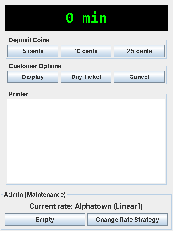

# PayStation


A parking pay station built **test-first** in Java. Customers insert coins, see how much parking time they've bought, and either buy a receipt or cancel and get their exact coins back. An admin panel empties the machine and switches between five towns' pricing rules at runtime, without touching the core pay-station code.

<!-- Add the Vercel URL here once deployed: **[▶ Try the live demo](https://YOUR-PROJECT.vercel.app)** — the real Swing app, running in the browser. -->

<p align="center"></p>

## Highlights

- **Test-driven development.** 30 JUnit tests cover coin validation, buy/cancel/empty behavior, every rate strategy, and boundaries like the exact 1-hour and 2-hour marks in progressive pricing.
- **Strategy pattern.** Pricing lives behind a `RateStrategy` interface. `PayStationImpl` never knows which town it's in, so adding a town means adding a class, not editing existing logic.
- **Testable time.** The weekday/weekend strategies take an injected `java.time.Clock`, so tests pin a Wednesday or a Saturday instead of passing or failing depending on the day they run.
- **Composition over duplication.** `AlternatingRateStrategy` combines two existing strategies (one for weekends, one for weekdays) instead of re-implementing their math.
- **Continuous integration.** GitHub Actions runs the full test suite on every push.

## Towns and rates

| Town      | Strategy     | Rule |
|-----------|--------------|------|
| Alphatown | Linear1      | 2 minutes per 5¢ |
| Betatown  | Progressive  | 2 min/5¢ for the first hour, 1.5 min/5¢ for the second, 1 min/5¢ after that |
| Gammatown | Alternating1 | Linear1 on weekends, Progressive on weekdays |
| Deltatown | Linear2      | 1 minute per 5¢ |
| Omegatown | Alternating2 | Free on weekends, Linear1 on weekdays |

Accepted coins: 5¢, 10¢, 25¢. Anything else throws `IllegalCoinException` and leaves the transaction untouched.

## Design

```
            «interface»                      «interface»
            PayStation  ◄──── PayStationImpl ────► RateStrategy
                                                      ▲
            ┌──────────────┬──────────────┬───────────┴───────────┐
     Linear1RateStrategy  Linear2   ProgressiveRateStrategy   AlternatingRateStrategy
                                                               ▲               ▲
                                                     Alternating1      Alternating2

   Town (enum) ── builds the right RateStrategy for each town
   CustomerPanel / AdminPanel (Swing) ── talk only to the PayStation interface
```

| File | Role |
|------|------|
| `PayStation`, `PayStationImpl` | Core logic: accept coins, track time and earnings, buy, cancel, empty |
| `RateStrategy` + implementations | One class per pricing rule |
| `Town` | Maps each town to its strategy; drives the admin menu |
| `CustomerPanel`, `AdminPanel`, `PayStationMain` | Swing GUI |
| `Receipt`, `ReceiptImpl` | Parking receipt |

## Run it

Requires Java 8+ and Maven.

```bash
mvn test                                  # run the test suite
mvn package                               # build target/paystation.jar
java -jar target/paystation.jar           # launch the GUI
```

Without Maven:

```bash
javac -d out src/main/java/edu/temple/cis/paystation/*.java
java -cp out edu.temple.cis.paystation.PayStationMain
```

## Browser demo

The `web/` folder is a static site that runs the actual Swing jar in the browser through [CheerpJ](https://cheerpj.com), a WebAssembly JVM. It's deployed on Vercel straight from this repo (`vercel.json` points at `web/`). After changing anything in `src/main`, rebuild the demo jar:

```bash
./scripts/build-web.sh
```

## Credits

Built by Cao, George, Islam, and Tessman for a Software Design course at Temple University. Based on the PayStation case study from Henrik Bærbak Christensen's *Flexible, Reliable Software: Using Patterns and Agile Development* (CRC Press, 2010); the interface files keep the book's original license notice.
